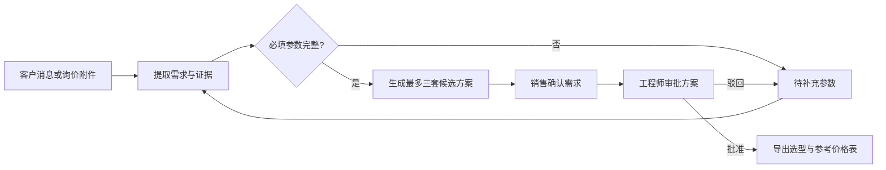

# AstrBot RFQ Plugin Edition

<div align="center">

**面向复杂产品询价、选型与商务协作的 AstrBot 本地插件版**

[](https://github.com/AstrBotDevs/AstrBot)
[](data/plugins/astrbot_plugin_rfq_assistant)
[](https://www.python.org/)
[](LICENSE)

</div>

> [!IMPORTANT]
> 这是基于 [AstrBot](https://github.com/AstrBotDevs/AstrBot) 4.29.1 改造的独立 Plugin Edition，不是 AstrBot 官方发行版。本仓库保留 AstrBot 的多平台消息、模型、插件、知识库与 Agent 能力，并增加了固定三入口 Dashboard 和工业离心泵询价工作台。

## 项目目标

客户发来询价时，往往只说明数量、流量或交期，却遗漏介质、温度、频率等关键参数。销售需要翻阅产品手册、寻找历史报价，并反复联系工程师确认。这个版本把上述过程整理为一个可追溯的协作流程：

1. 从客户消息和附件中提取需求与原文证据。
2. 明确指出缺失参数，不用猜测代替客户确认。
3. 使用结构化产品目录执行确定性筛选与排序。
4. 同时展示最多三套候选方案，供销售和工程师复核。
5. 完成销售确认、工程审批后，导出带免责声明的 Excel。

模型只负责理解资料和抽取字段；产品、价格、硬约束匹配及排序由代码和产品目录决定。

## 三个固定入口

登录后的 Dashboard 只有三个一级入口：

| 入口 | 路由 | 用途 |
| --- | --- | --- |
| 机器人对话 | `/chat` | 查看机器人与飞书、钉钉、QQ 等外部消息平台之间的真实对话；不展示 Dashboard WebChat 会话 |
| 机器人配置 | `/bot-config/:section` | 集中管理当前机器人、模型与提供商、消息平台、插件、MCP、Skills、人格、知识库、定时任务、日志和系统设置 |
| 询价工作台 | `/workbench` | 创建询价、补齐参数、比较方案、上传附件、确认需求、技术审批、导入目录和导出 Excel |

旧 WebUI 路由仍会重定向到对应的新入口。独立 `/chatbox` 兼容入口保留，但不出现在主菜单中。

新安装必须至少配置一个可用对话模型和一个消息平台，之后才会解锁机器人对话与询价工作台。

## 询价工作台

### 支持的业务流程



状态依次为：

```text
draft
  → needs_clarification
  → awaiting_sales_confirmation
  → awaiting_technical_review
  → approved_for_export
```

任何需求修改都会生成新修订版，并撤销旧的销售确认和工程审批。并发编辑使用修订号检测冲突，不会静默覆盖其他人的改动。

### 需求字段

当前演示场景固定为工业离心泵，提取以下信息：

- 客户与项目、数量、预算、交期；
- 流量、扬程、介质、温度；
- 电压、频率、材质要求、安装环境；
- 其他软偏好及每项参数的原文证据。

字段来源区分为 `explicit`、`inferred` 和 `manual`。只有客户明确提供或人工确认的必填项才算完整。

### 确定性选型

硬约束包括流量、扬程、介质兼容性、温度、电压和频率。通过硬约束后，再根据工作区间裕量、温度裕量、参考价格和交期排序，最多保留三个不同方案。

首次运行会写入五个明确标记为虚构演示数据的型号：

- `CP-32-125E`
- `CP-40-160E`
- `CP-40-160S`
- `CP-50-200H`
- `CP-65-250H`

工作台可以下载固定列结构的产品目录模板，并原子导入 `.xlsx` 新版本。参考价格只能来自结构化产品目录，知识库、历史报价和模型输出不能覆盖价格。

> [!WARNING]
> 所有内置价格均为虚构演示参考价。系统不计算小计、总计、税费、折扣或运费，也不会自动向客户发送报价。所有导出文件均标注：**演示参考价，需商务核价，不得直接作为正式报价。**

### 附件与 Agent 工具

支持读取 PDF、DOCX、XLSX、XLS、Markdown 和 TXT。单个文件最大 10 MB，每条消息最多处理 3 个附件。附件内容始终作为不可信资料处理，其中的提示词或指令不会改变产品目录、价格或匹配规则。

插件注册三个 Agent 工具：

| 工具 | 作用 |
| --- | --- |
| `rfq_create_case(request_text)` | 从当前消息及附件创建询价 |
| `rfq_update_case(case_id, clarification_text)` | 补充参数并生成新修订版 |
| `rfq_get_case(case_id)` | 查询缺失参数、候选方案和审批状态 |

聊天可以创建、补充和查询询价，但不能执行销售确认、工程审批或 Excel 导出；这些操作只能在工作台完成。

## 快速启动

### 环境要求

- macOS、Linux 或 Windows；双击脚本为 macOS 专用；
- Python 3.12 或更高版本；
- [uv](https://docs.astral.sh/uv/)；
- Node.js 与 [pnpm](https://pnpm.io/)；
- Git。

### 1. 克隆仓库

```bash
git clone https://github.com/szaash666-lang/AstrBot-RFQ-Plugin-Edition.git
cd AstrBot-RFQ-Plugin-Edition
```

### 2. macOS 一键启动

在 Finder 中双击：

```text
启动AstrBot.command
```

也可以在终端执行：

```bash
open 启动AstrBot.command
```

首次启动时，脚本会在需要时执行 `uv sync`、安装 Dashboard 依赖、构建本地 Dashboard，然后在后台启动 AstrBot 并打开：

```text
http://localhost:6185/#/chat
```

停止服务时双击 `关闭AstrBot.command`，或执行：

```bash
open 关闭AstrBot.command
```

### 3. 命令行启动

```bash
./scripts/astrbot.sh start
```

常用命令：

```bash
./scripts/astrbot.sh status   # 查看状态
./scripts/astrbot.sh logs     # 查看实时日志
./scripts/astrbot.sh restart  # 重启
./scripts/astrbot.sh stop     # 停止
```

如果依赖尚未安装，也可以手动准备环境：

```bash
uv sync
cd dashboard
pnpm install --frozen-lockfile
pnpm build
cd ..
./scripts/astrbot.sh start
```

### 4. 首次登录

首次启动会生成随机初始密码。用户名通常为 `astrbot`，请在启动日志中查找初始密码：

```bash
./scripts/astrbot.sh logs
```

首次登录后请立即修改用户名和密码。不要把密码、日志或 `data/` 下的运行配置提交到公开仓库。

### 5. 完成机器人配置

进入“机器人配置”，依次完成：

1. 在“模型与提供商”中添加至少一个对话模型，并将其绑定到当前机器人档案。
2. 在“消息平台”中添加并启用至少一个平台。
3. 在“插件与扩展”中确认“询价选型助手”已启用。
4. 按需配置 RFQ 分析模型和产品资料知识库。

RFQ 插件只有两个配置项：

| 配置项 | 说明 |
| --- | --- |
| `analysis_provider_id` | 用于结构化提取需求的模型；聊天场景未填写时尝试使用当前会话模型 |
| `knowledge_base_names` | 可选的产品手册与历史案例知识库；只提供证据，不参与定价 |

## 数据与安全

运行数据保存在本地 `data/` 目录，并由 Git 忽略。主要包括账号配置、密码哈希、SQLite 数据库、附件、日志、知识库、Excel 导出和缓存。

RFQ 插件自己的运行数据位于：

```text
data/plugin_data/astrbot_plugin_rfq_assistant/
```

请勿把该目录公开。插件数据库会记录询价修订、目录版本、推荐运行、审批与审计事件，以保证结果可追溯。

启动脚本默认设置 `ASTRBOT_UPDATES_DISABLED=1`，暂停核心与 Dashboard 的版本更新，防止官方更新覆盖本地 Plugin Edition 改动。需要同步上游时，应先在独立分支中审查和合并代码。

## 目录说明

```text
AstrBot-RFQ-Plugin-Edition/
├── astrbot/                         # AstrBot 后端及更新暂停逻辑
├── dashboard/                       # 三入口 Vue Dashboard
│   └── src/views/rfq/               # 原生询价工作台页面
├── data/plugins/
│   └── astrbot_plugin_rfq_assistant/ # RFQ 插件、规则、存储、Excel 与兼容工作台
├── docs/                            # 中英文 WebUI 使用说明
├── scripts/astrbot.sh               # 后台启动、停止、状态和日志脚本
├── 启动AstrBot.command               # macOS 一键启动
└── 关闭AstrBot.command               # macOS 一键停止
```

## 开发与检查

Python：

```bash
uv run ruff format .
uv run ruff check .
uv run ruff check --no-respect-gitignore data/plugins/astrbot_plugin_rfq_assistant
uv run pytest -q data/plugins/astrbot_plugin_rfq_assistant/tests
```

Dashboard：

```bash
cd dashboard
node --test tests/*.test.mjs
pnpm typecheck
pnpm i18n:check
pnpm build
```

## 当前边界

- 只提供离心泵演示，不是跨品类 CPQ 平台。
- 不连接 ERP、CRM 或正式价格系统。
- 不实现税费、折扣、运费、正式总价和自动发件。
- 演示版审批不做复杂角色权限控制，但会记录操作者。
- 知识库不可用时，仍可依据结构化产品目录完成缺参和选型。

## 上游与许可证

本项目基于 [AstrBotDevs/AstrBot](https://github.com/AstrBotDevs/AstrBot) 开发。AstrBot 的完整功能、平台支持和官方文档请访问：

- [AstrBot 官方网站](https://astrbot.app/)
- [AstrBot 官方文档](https://docs.astrbot.app/)
- [AstrBot 上游仓库](https://github.com/AstrBotDevs/AstrBot)

本仓库沿用 [GNU AGPL v3 or later](LICENSE) 许可证。发布或部署修改版本时，请遵守许可证中的源代码公开义务。
